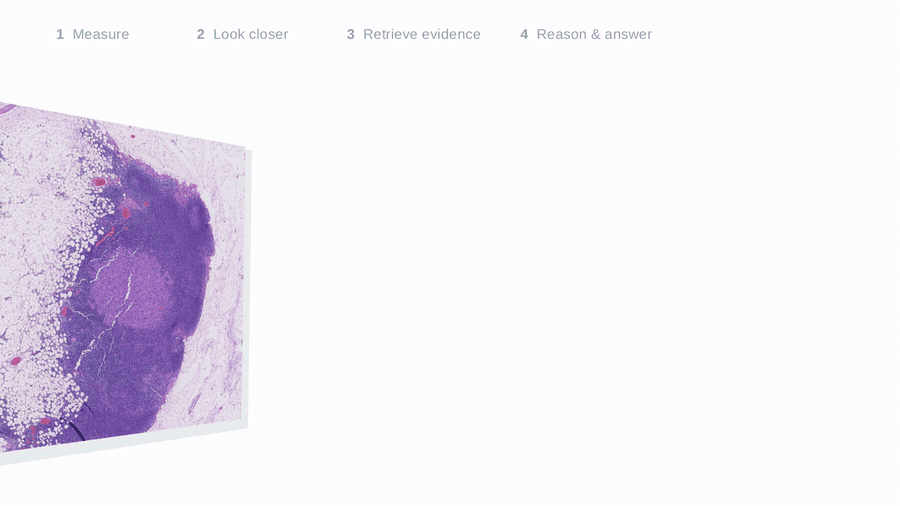
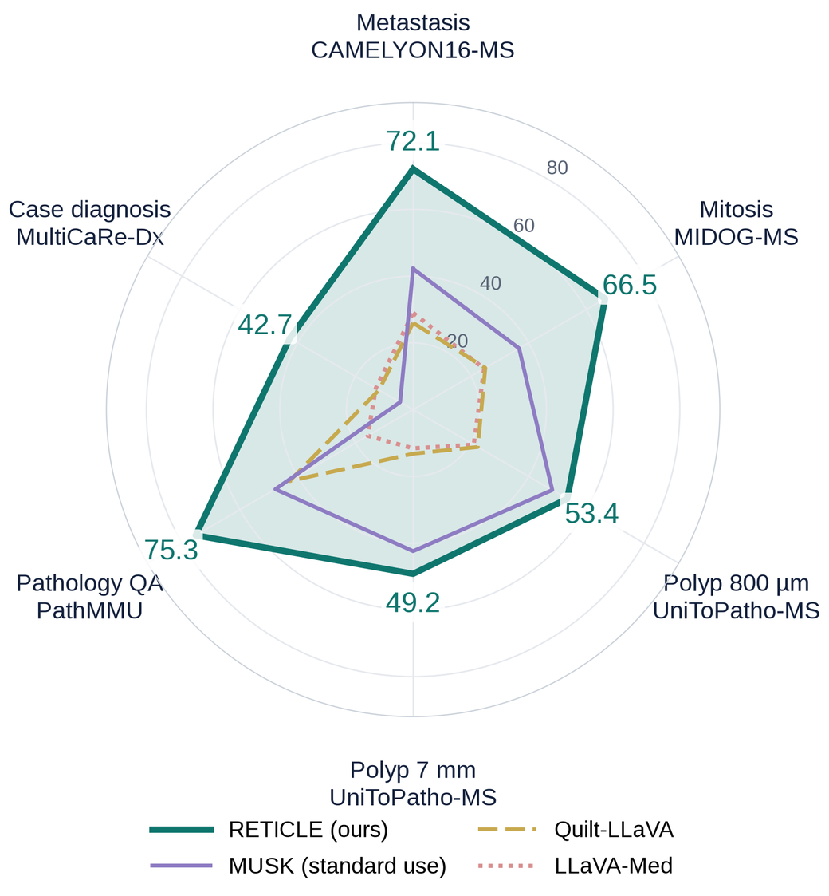

# RETICLE

*A project for the [2026 Ashby Prize in Computational Science Hackathon](https://ai.ncsa.illinois.edu/education/2026-ashby-prize-in-computational-science-hackathon/), co-organized by the Cancer Center at Illinois (CCIL) and the Center for Artificial Intelligence Innovation at NCSA, University of Illinois.*

**RE**asoning over expert **T**ools, **I**nspected **C**rops and **L**iterature **E**vidence: a general-purpose pathology agent that measures, looks closer and retrieves evidence.

RETICLE lets a general vision–language model (Qwen3.8-27B, used as released) answer pathology questions that it cannot answer from a downsampled image alone. Through one tool interface it

1. **measures** with a mixture of specialized RETICLE experts, one each for lymph-node metastasis sizing, mitosis counting and colorectal polyp grading, built on MUSK and calibrated; a router lets the agent pick the expert, or none, from the image and the question;
2. **looks closer** at full-resolution views cut where an expert located the finding;
3. **retrieves evidence** from published case reports, teaching image–caption pairs and NCI PDQ treatment summaries, and cites the exact source sentence for every claim it takes from them;
4. carries the readings, views and evidence through a **multi-turn consultation** (diagnosis → work-up → treatment).

<p align="center"></p>

A recording of the interactive demo (a breast-cancer field opened from a folder, the mitosis expert run live, a cited follow-up answer) is in [assets/reticle_demo.mp4](assets/reticle_demo.mp4).

## Results

Test-set scores (%): balanced accuracy, PathMMU accuracy and MultiCaRe-Dx top-1 diagnosis. *MUSK* is the standard use of the foundation model: a linear probe (mean of 10 seeds), zero-shot on PathMMU, and the nearest published case on MultiCaRe-Dx. *LLaVA-Med* (v1.5) and *Quilt-LLaVA* (v1.5-7B) are pathology VLMs given the same images and questions.

| Benchmark (test items) | RETICLE | MUSK | LLaVA-Med | Quilt-LLaVA |
|---|---:|---:|---:|---:|
| CAMELYON16-MS, metastasis size (188) | **72.1** | 42.2 | 29.0 | 26.0 |
| MIDOG-MS, mitosis count (240) | **66.5** | 36.7 | 24.6 | 25.0 |
| UniToPatho-MS 800 µm, polyp type and grade (2,399) | **53.4**¹ | 48.2 | 21.0 | 22.4 |
| UniToPatho-MS 7 mm, polyp type and grade (248) | **49.2** | 42.4 | 11.6 | 13.2 |
| PathMMU, pathology QA (4,538) | **75.3** | 47.7 | 15.7 | 42.8 |
| MultiCaRe-Dx, case diagnosis top-1 (1,000) | **42.7** | 4.5 | 12.9 | 11.8 |

¹ The polyp expert's reading; the agent's own answer with the reading and the views reaches 47.6.

<p align="center"></p>

<p align="center"><b>RETICLE outperforms every baseline on all six benchmarks.</b></p>

The benchmarks are described in [docs/benchmarks.md](docs/benchmarks.md); the commands behind every number of the table, RETICLE and each baseline, are in [docs/evaluation.md](docs/evaluation.md).

## Repository layout

```
reticle/
  agent/          consultation agent (consult.py), expert router (router.py), evidence index (library.py), region and image question answering (region_qa.py, vlm_qa.py)
  experts/        RETICLE experts: metastasis/, mitosis/, polyp/; the tool contract and its calibration (contract.py, build_contracts.py); live tools for the demo (live.py)
  library/        evidence library: published case reports (cases.py), teaching image-caption pairs (captions.py), NCI PDQ passages (pdq.py), MUSK encoding of the caption library (encode.py), caption retrieval for PathMMU (retrieve_captions.py)
  benchmarks/     builders of CAMELYON16-MS, MIDOG-MS, UniToPatho-MS, MultiCaRe-Dx and the PathMMU inputs
  evaluation/     scoring of the region benchmarks, PathMMU and the consultations; baselines (baselines/: MUSK, LLaVA-Med, Quilt-LLaVA)
  demo/           demo server and web page
  encoders.py     MUSK image/text encoder wrapper
  image_io.py     PNG decoding limits for library images with large ICC profiles
  paths.py        data root (RETICLE_DATA)
configs/          models.json, experts/ (training recipes), evaluation/ (agent arms, consultation prompts), library_cases.json (MultiCaRe release and excluded articles), pathmmu.json (caption library decontamination), demo examples
docs/             expert training, expert interface, benchmarks, evaluation map
docker/           runtime image
assets/           figures and videos for this README
```

## Setup

**Runtime image.** Everything except the VLM runs in the image built from `docker/Dockerfile` (PyTorch 2.7.1, CUDA 12.6; MUSK code pinned to commit `714b666`):

```bash
docker build -t reticle -f docker/Dockerfile .
```

The two runners that load the VLM in-process, `reticle.agent.vlm_qa` and `reticle.agent.region_qa` without `--api_ports`, run inside the vLLM image instead.

**Models.** MUSK weights are read from the Hugging Face hub (`xiangjx/musk`, revision in `configs/models.json`; accept the model's terms first). The agent talks to an OpenAI-compatible vLLM server:

```bash
docker run --gpus '"device=0"' --ipc host -p 127.0.0.1:8930:8930 vllm/vllm-openai:v0.31.0 \
  Qwen/Qwen3.8-27B --served-model-name qwen --host 0.0.0.0 --port 8930 \
  --max-model-len 32768 --limit-mm-per-prompt '{"image":8}' --enable-prefix-caching
```

**Expert weights.** The trained expert checkpoints are not released because MUSK's licence does not permit it. MUSK is distributed under CC-BY-NC-ND 4.0, which does not allow sharing adapted versions of the model, and its terms of use, accepted when downloading it, forbid distributing copies of it. The metastasis and mitosis experts fine-tune the whole MUSK backbone, so their checkpoints are modified copies of MUSK. Anyone who has accepted MUSK's terms can train the experts with [docs/expert_training.md](docs/expert_training.md).

**Data.** Set `RETICLE_DATA` to a data root; benchmark builders, expert training, the evidence library and evaluation read and write below it. Source datasets are not redistributed: CAMELYON16 and CAMELYON17 (CC0), MIDOG 2021 (CC BY 4.0) and MIDOG++ (CC0), UniToPatho, PathMMU, the MultiCaRe case-report collection (CC BY / CC0 articles), Quilt-1M, a PathGen sample and the NCI PDQ cancer treatment summaries. See [docs/benchmarks.md](docs/benchmarks.md) for where each comes from and how it is laid out.

Run commands inside the image with the repository mounted, for example:

```bash
docker run --rm -e RETICLE_DATA=/data -v /path/to/data:/data -v $PWD:/workspace reticle \
  python -m reticle.evaluation.score_regions --config configs/evaluation/region_comparisons.json --out /data/results/regions_test.json
```

GPU steps add `--gpus`, and steps that call a vLLM server on the host add `--network host`.

## Usage

The order of a full reproduction:

1. **Evidence library**: published case reports (`reticle.library.cases download`, `build`, `encode`), teaching image–caption pairs (`reticle.library.captions`, which also extracts the PathMMU question images) and NCI PDQ passages (`reticle.library.pdq`); [docs/benchmarks.md](docs/benchmarks.md#evidence-library--reticlelibrary) lists the sources.
2. **Benchmarks**: `python -m reticle.benchmarks.camelyon16_ms`, `midog_ms`, `unitopatho_ms`, `multicare_dx` (from the case library), `pathmmu` (after the caption library); each module's docstring lists its steps.
3. **Experts**: train, cross-fit and calibrate the three experts with the commands in [docs/expert_training.md](docs/expert_training.md), in order. The record format is described in [docs/expert_interface.md](docs/expert_interface.md). The trained experts are not included (see *Expert weights* above).
4. **Caption vectors and PathMMU evidence**: MUSK vectors of the caption library and the PathMMU images (`reticle.library.encode`), then the caption retrieval for PathMMU (`reticle.library.retrieve_captions`).
5. **RETICLE, baselines and scoring**: region questions (`reticle.agent.region_qa`, which routes each question to its expert with `reticle.agent.router`, and `reticle.evaluation.score_regions`), PathMMU (`reticle.agent.vlm_qa`, `reticle.evaluation.score_pathmmu`), consultations (`reticle.evaluation.consultation`), and the MUSK, LLaVA-Med and Quilt-LLaVA baselines (`reticle.evaluation.baselines`); [docs/evaluation.md](docs/evaluation.md) lists the commands.

Every entry point prints its options with `python -m <module> --help`; `tests/` holds unit tests for the citation check and the expert calibration (`pytest tests`).

**Demo.** With the vLLM server on port 8930:

```bash
python -m reticle.demo.server --port 8875 --llm-port 8930
```

then open `http://127.0.0.1:8875`. The page offers large-image benchmark examples with expert readings (built by `reticle.demo.examples`), published case images, uploads and files from a local folder (`--inputs`); an uploaded breast-cancer field or colorectal polyp region can be read live by the mitosis or polyp expert, chosen by hand or by the router from the case information. The live mitosis expert loads the five fine-tuned detectors written by `reticle.experts.mitosis.crossfit`, so it needs the experts trained first; the polyp expert refits its classifiers on the cached MUSK features of the training regions. Every citation opens its source sentence. The server binds to the loopback interface only.

## Notes

- RETICLE is a research prototype, not a medical device.
- MUSK and everything derived from it (the experts and their outputs) may be used only for non-commercial academic research, under the MUSK licence.
- MultiCaRe-Dx gold fields were extracted, and answers judged, by the same model family; UniToPatho-MS results are exploratory because the set was used during development.
- Answers of the reasoning model vary by about three points between runs because of batched inference.

## Acknowledgements

MUSK (Xiang et al., 2025) is the backbone of every expert. Datasets: CAMELYON16/17, MIDOG 2021 and MIDOG++, UniToPatho, PathMMU, MultiCaRe, Quilt-1M and NCI PDQ.
